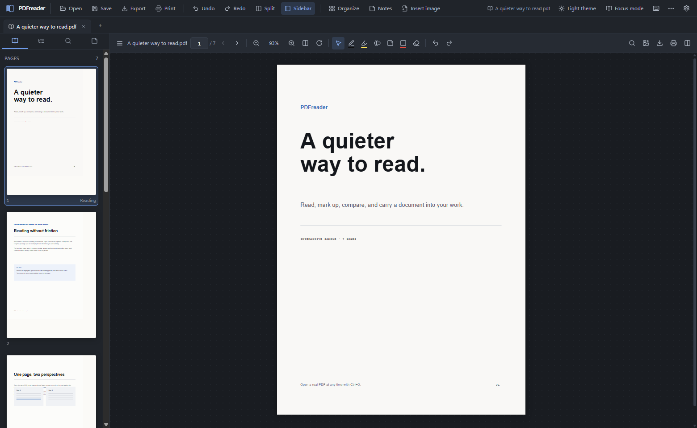
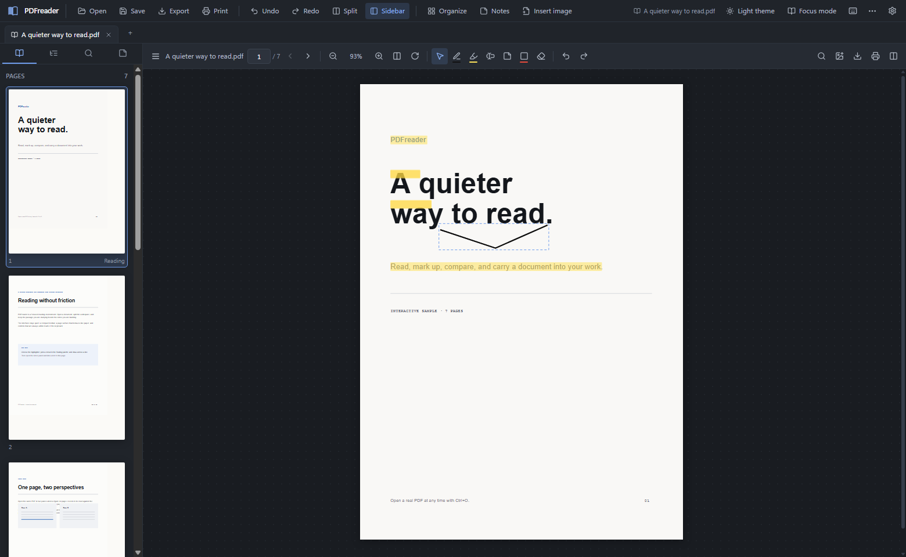

# PDFreader

A Windows-first desktop workspace for reading PDFs, opening several documents side by side, drawing on pages, keeping linked notes, organizing pages, and exporting annotated or converted copies.

PDFreader is built with **Tauri 2**, **React 19 + TypeScript**, **PDF.js** for the interactive viewer, and a bundled **PDFium** native engine for page counts and thumbnails. Documents stay local; the viewer and all core note/annotation functions work offline.

## Downloads

Prebuilt Windows binaries (NSIS installer and portable executable) are published under [GitHub Releases](https://github.com/refat-pasha/PDFreader/releases). Both are unsigned, so Windows SmartScreen may show "Windows protected your PC" — choose **More info → Run anyway** only if you trust the build. SHA-256 checksums are attached to each release.



Text selection is a first-class reading action. Select a passage and choose **Highlight** or **Quote in note**; highlights are stored as editable draft markup and flattened into exported PDFs.

The dialog system traps keyboard focus, focuses the first control, closes with Escape, and restores focus to the triggering control.



## What works today

- **Reading:** tabs with middle-click close and close/other/all context actions, up to four panes with draggable/keyboard-accessible split dividers, fit-page/fit-width/custom zoom, rotation, page input, page buttons, mouse-wheel page turn, keyboard navigation, thumbnails, real PDF outline, labeled page bookmarks, password-protected PDF unlocking, text selection/copy, and search within one PDF or across all open documents with in-page match highlighting.
- **Annotations:** selectable-text highlighting, pen, highlighter, rectangle/ellipse/arrow, free text, margin notes, image stamps, eraser selection, selection/move, undo/redo, size/color/opacity palette.
- **Notes:** Markdown notebook with page-linked backlinks, quote selected passage directly into a note, standalone Markdown notebook export, automatic local persistence, and export into created documents.
- **Editing:** page organizer supports reorder, rotate 90°, and delete; applying creates an edited copy rather than overwriting the original.
- **Export:** annotated PDF with flattened markup, DOCX (editable text or visual pages with notes), legacy `.doc` through LibreOffice when installed, Markdown, TXT, PNG, and multi-page ZIP.
- **OCR:** Windows built-in OCR is used automatically for scanned-page text/Markdown/Word exports when an OCR language is installed. Tesseract is an optional alternative for additional languages.
- **Desktop integration:** native file open/save dialogs, recent-file menu, single instance with PDF path forwarding, PDF file association, window-state restoration, per-user NSIS installer, and a Settings panel showing native engine/optional component availability.
- **Persistence:** annotations and notes are saved in local application storage; the desktop workspace reopens local PDFs with their tabs, panes, pages, zoom, and rotation after a restart. Exports write atomically through a temporary file.

## Known limitations

- The current renderer is **PDF.js**; the native PDFium integration from the original architecture is deferred. The PDF engine boundary is isolated so the decision can be revisited without rewriting the workspace.
- Original PDF text is not directly editable. PDF text is positioned glyph data, not flowing paragraphs; safe text editing needs font and layout reconstruction. Use text annotations or export to DOCX for editing.
- DOCX export is a practical document, not guaranteed pixel-perfect Word reconstruction. Use **Editable text** for flowing Word paragraphs or **Preserve page layout** for annotated page images.
- Browser preview cannot reopen local PDFs after a restart because browser file handles are not retained; desktop session restoration is supported.
- Annotations flatten into visible page content in exported PDFs. Editable draft markup lives in PDFreader's local workspace for the original document; flattening is intentionally one-way in this version.
- Digital signatures are not implemented. Saving a flattened copy invalidates signatures; save to a new file.
- Secure redaction is not offered. Black rectangles are not redaction.
- Encrypted PDFs can be read after entering the password. Passwords remain in memory for the session and are never written to disk. Flattened PDF export of an encrypted source is not supported; Markdown/TXT/DOCX export works after unlocking.
- OCR depends on installed Windows OCR language packs; Tesseract can be added for extra languages. Export OCR runs only in the desktop build.
- `.doc` requires LibreOffice; otherwise the app creates DOCX and clearly reports the fallback.
- On Windows 11 26H2 build 26200, the installed WebView2 156 runtime currently crashes with `STATUS_BREAKPOINT`; this is a host runtime regression. The app includes optional fixed-runtime detection, but this specific host still failed even with the fixed 155 runtime. See [docs/webview2-compat.md](docs/webview2-compat.md) and [docs/VERIFICATION.md](docs/VERIFICATION.md). For this host, launch **Start PDFreader (browser fallback).cmd** to use the same production UI in an Edge app window.

## Development

Prerequisites on Windows:

- Node.js 20+ and pnpm
- Rust stable with the MSVC target
- Visual Studio 2022 Build Tools with the C++ workload
- WebView2 runtime (installed on Windows 11; bootstrapped by the installer on Windows 10)

```powershell
pnpm install
pnpm dev                 # browser development at http://127.0.0.1:1420
pnpm tauri dev           # desktop development window
pnpm build               # type-check + production web build
pnpm test                # unit and PDF export tests
pnpm tauri build         # NSIS installer in src-tauri/target/release/bundle/nsis
```

The browser build cannot read arbitrary local paths; use the desktop build for open/save integration. The demo PDF is generated locally and requires no sample assets.

### Optional components

- **Tesseract OCR:** optional alternative to Windows OCR for additional languages. The app detects `C:\Program Files\Tesseract-OCR\tesseract.exe`.
- **Word 97:** install LibreOffice. The app detects `C:\Program Files\LibreOffice\program\soffice.exe`.

## Smoke tests

With Chrome running headlessly on the CDP port:

```powershell
node scripts/ui-smoke.mjs http://127.0.0.1:1420 tests/.artifacts/app.png
node scripts/ui-actions.mjs http://127.0.0.1:1420
```

The action test draws an annotation, splits the pane, opens the notebook, and opens the export dialog.

## Repository map

```text
src/
  app/                  file service and local persistence
  features/workspace/   store, panes, tabs, page organizer
  features/viewer/      PDF.js loading, page rendering, thumbnails
  features/annotate/    annotation model, layer, palette, markup panel
  features/notes/       Markdown notes and links
  features/export/      PDF, DOCX, Markdown, text and image exporters
  features/shell/       menus, dialogs, command palette, shortcuts
src-tauri/              Tauri native shell and secure file commands
scripts/                CDP UI verification scripts
docs/                   architecture, data formats, QA and release notes
```

## Privacy and safety

- No cloud services, telemetry, or AI calls.
- The renderer cannot invoke arbitrary shell commands or access arbitrary paths outside the validated native commands.
- PDF JavaScript and automatic external actions are not enabled.
- Exports are written to a temporary sibling and atomically moved into place.
- A corrupt local draft is ignored at startup instead of blocking the reader.

See [docs/ARCHITECTURE.md](docs/ARCHITECTURE.md), [docs/QA.md](docs/QA.md) and [docs/SHORTCUTS.md](docs/SHORTCUTS.md) for more detail.
